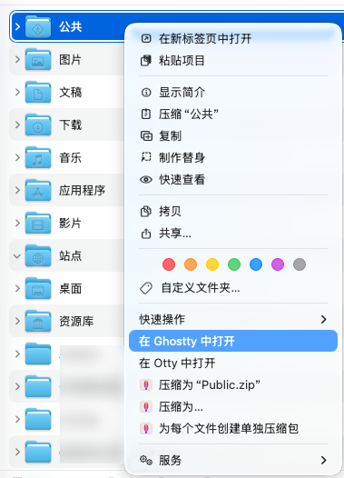

# Finder Terminals

[简体中文](README.md) · **English**

On macOS, right-click a single folder in Finder to open it directly in Ghostty or Otty. The two top-level menu items currently use Chinese labels.

- **在 Ghostty 中打开** (Open in Ghostty)
- **在 Otty 中打开** (Open in Otty)

The selected folder becomes the terminal's working directory. The two items appear only for a single ordinary folder. Existing services remain in Finder's Services submenu.

## Screenshot



## Requirements

- Tested on Apple silicon with macOS 26.6.2, Ghostty 1.4.0, and Otty 1.6.5. Other macOS versions, Intel Macs, and cloud storage folders are untested.
- Install [Ghostty](https://ghostty.org/) and [Otty](https://otty.sh/) first.
- Building requires the Xcode Command Line Tools and Python 3.9 or later. Check with `xcode-select -p` and `python3 --version`. To install the command line tools, run `xcode-select --install`.

## Build

```sh
git clone https://github.com/Undefinedefity/finder-terminals.git
cd finder-terminals
./build.sh
```

The script compiles the Objective-C source with `clang` and creates `build/Finder Terminals.app`. It applies an ad hoc signature to the extension and then to the host app, and verifies both signatures. An Apple Developer account is optional.

## Install

Run these commands from the repository root. Your account needs write access to `/Applications`.

```sh
(
  set -e
  app="/Applications/Finder Terminals.app"
  extension="$app/Contents/PlugIns/Finder Terminals Extension.appex"

  if [ -e "$app" ]; then
    printf '%s\n' "$app already exists. Follow the uninstall steps before reinstalling." >&2
    exit 1
  fi

  mkdir -p -m 700 "$HOME/Library/Application Support/Finder Terminals/Requests"
  ditto "build/Finder Terminals.app" "$app"
  codesign --verify --deep --strict "$app"
  /System/Library/Frameworks/CoreServices.framework/Frameworks/LaunchServices.framework/Support/lsregister -f "$app"
  pluginkit -a "$extension"
  pluginkit -e use -i local.finder-terminals.extension
)
```

You can check whether Finder Terminals is enabled under **System Settings → General → Login Items & Extensions → Finder Extensions**. If the items are missing from an open Finder window, hold Option, right-click the Finder icon in the Dock, and choose **Relaunch**.

## Verify

1. Run `pluginkit -m -v -i local.finder-terminals.extension`. Confirm that the extension under `/Applications/Finder Terminals.app` has a `+` next to it.
2. Right-click a local folder in Finder's file list. Confirm that both entries appear at the top level and that other services are still in the **Services** submenu.
3. Click each entry and run `pwd` in the resulting terminal. Both should print the selected folder's path. Use a folder named `终端 Test Folder` to cover Chinese characters and spaces in the same check.
4. Right-click a regular file in the same location and confirm that the two entries are absent.

## Uninstall

Disable and unregister the extension.

```sh
pluginkit -e ignore -i local.finder-terminals.extension
pluginkit -r "/Applications/Finder Terminals.app/Contents/PlugIns/Finder Terminals Extension.appex"
```

In Finder, move `Finder Terminals.app` from **Applications** to the Trash. You can also use **Go to Folder** to open `~/Library/Application Support/` and move the `Finder Terminals` folder to the Trash. If an open Finder window still shows the menu items, relaunch Finder and check again.

## Implementation

- `FinderTerminals.m` implements the Finder Sync extension. It returns the menu when you right-click a single folder. A menu action writes the target app, folder path, and timestamp to a temporary local request.
- `Host.m` implements the host app. It reads and deletes the request, checks the target app and timestamp, and passes the folder to Ghostty or Otty as a file URL using `NSWorkspace`.
- `Requests.h` defines the two app bundle identifiers and the current user's request directory at `~/Library/Application Support/Finder Terminals/Requests/`.

In testing, macOS denied the sandboxed extension's direct `NSWorkspace` request to open the terminal with the folder. The host app handles that step. For another example of extension registration and handoff to a host app, see the [mac-finder-menu technical notes](https://github.com/sherman-yang/mac-finder-menu/blob/main/docs/FINDINGS.md#1-getting-an-item-into-the-finder-context-menu).
