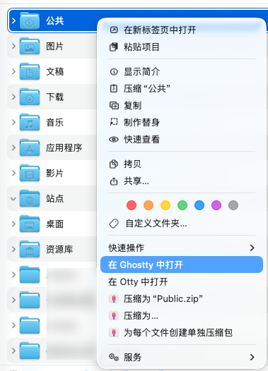

# Finder Terminals

在 macOS 的 Finder（访达）中右键单个普通文件夹，一级菜单会出现两个入口。

- **在 Ghostty 中打开**
- **在 Otty 中打开**

终端以所选文件夹为工作目录。普通文件和多选不会显示这两项。原有服务继续由 macOS 放在「服务」子菜单里。

## 截图



## 环境

- 在 Apple Silicon、macOS 26.6.2、Ghostty 1.4.0 和 Otty 1.6.5 上验证。其他 macOS 版本、Intel Mac 和云盘目录未验证。
- 先安装 [Ghostty](https://ghostty.org/) 和 [Otty](https://otty.sh/)。
- 构建需要 Xcode Command Line Tools 和 Python 3.9 或更新版本。可用 `xcode-select -p` 和 `python3 --version` 检查。缺少命令行工具时，运行 `xcode-select --install`。

## 编译

```sh
git clone https://github.com/Undefinedefity/finder-terminals.git
cd finder-terminals
./build.sh
```

构建脚本用 `clang` 编译 Objective-C 源码，生成 `build/Finder Terminals.app`，再对扩展和宿主依次做本地签名并验证签名。无需 Apple Developer 账号。

## 安装

在仓库根目录执行。当前账号需要有权写入 `/Applications`。

```sh
(
  set -e
  app="/Applications/Finder Terminals.app"
  extension="$app/Contents/PlugIns/Finder Terminals Extension.appex"

  if [ -e "$app" ]; then
    printf '%s\n' "已存在 $app。请先按下文卸载，再重新安装。" >&2
    exit 1
  fi

  mkdir -p -m 700 "$HOME/Library/Application Support/Finder Terminals/Requests"
  ditto "build/Finder Terminals.app" "$app"
  codesign --verify --deep --strict "$app"
  /System/Library/Frameworks/CoreServices.framework/Frameworks/LaunchServices.framework/Support/lsregister -f "$app"
  pluginkit -a "$extension"
  pluginkit -e use -i local.finder-terminals.extension
)
```

也可在「系统设置 → 通用 → 登录项与扩展 → Finder 扩展」中检查 Finder Terminals 是否已启用。如果现有 Finder 窗口还没显示新菜单，按住 Option 右键程序坞中的 Finder 图标，选择「重新开启」。

## 验证

1. 运行 `pluginkit -m -v -i local.finder-terminals.extension`，确认结果包含 `/Applications/Finder Terminals.app` 下的扩展，条目前有 `+`。
2. 在 Finder 的文件列表中右键一个本地文件夹。确认两个入口都在一级菜单，其他服务仍在「服务」里。
3. 分别点击两个入口。在各自打开的终端里运行 `pwd`，确认输出都是所选文件夹的路径。可以用名为 `终端 Test Folder` 的测试文件夹顺便检查中文和空格。
4. 右键同级的普通文件，确认它没有这两个入口。

## 卸载

先停用并注销扩展。

```sh
pluginkit -e ignore -i local.finder-terminals.extension
pluginkit -r "/Applications/Finder Terminals.app/Contents/PlugIns/Finder Terminals Extension.appex"
```

然后在 Finder 中将「应用程序」里的 `Finder Terminals.app` 移到废纸篓。通过 Finder 的「前往文件夹」打开 `~/Library/Application Support/`，也可将其中的 `Finder Terminals` 目录移到废纸篓。如果打开的 Finder 窗口仍显示这两项，重新开启 Finder 后再检查。

## 实现

- `FinderTerminals.m` 实现 Finder Sync 扩展。仅在右键选中一个文件夹时返回菜单，点击后把目标 App、文件夹路径和时间写入本地临时请求。
- `Host.m` 实现宿主 App。它读取并删除请求，校验目标 App 和请求时间，再通过 `NSWorkspace` 将目录直接交给 Ghostty 或 Otty。路径作为文件 URL 传递。
- `Requests.h` 定义两个目标 App 的标识符及请求目录。临时请求目录位于当前用户的 `~/Library/Application Support/Finder Terminals/Requests/`。

宿主负责打开目录，因为实测中 Finder 扩展直接调用 `NSWorkspace` 打开这两个终端会被 macOS 拒绝。类似的扩展注册和宿主转交机制可见 [mac-finder-menu 的技术笔记](https://github.com/sherman-yang/mac-finder-menu/blob/main/docs/FINDINGS.md#1-getting-an-item-into-the-finder-context-menu)。
